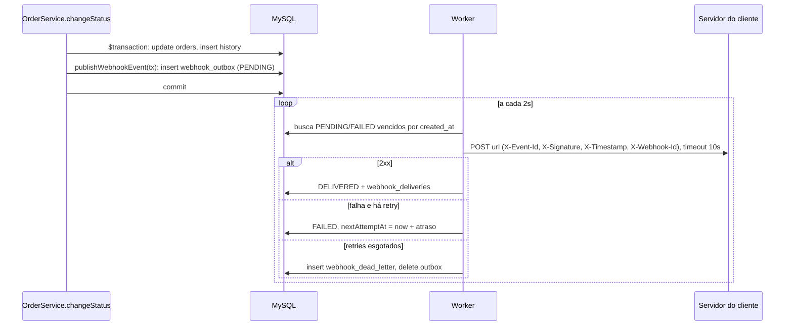

### FDD: Sistema de Webhooks de Notificação de Pedidos

Versão: 1.0
Data: 2026-11-15
Responsável: [a definir]

Convenções: cada item traz sua origem entre parênteses, `(src: [hh:mm] Nome)` para a transcrição ou `(src: <caminho>)` para o código. `[PROPOSTA]` marca detalhe de design que a reunião não definiu, sempre com a decisão que o motiva. `[NEEDS INPUT: ...]` marca lacuna que exige decisão humana. As justificativas das decisões ficam nos ADRs linkados; este documento descreve apenas o como.

---

### 1. Contexto e motivação técnica

Hoje a mudança de status de um pedido acontece em `OrderService.changeStatus`, dentro de um único `this.prisma.$transaction`, que relê o pedido, valida a transição com `canTransition`, debita ou repõe estoque, atualiza `orders` e grava `order_status_history` (src: src/modules/orders/order.service.ts; [09:04] Bruno). Não existe no código nenhum mecanismo de evento, fila, outbox ou worker (src: docs/auxiliar/contexto-codigo.md).

Restrições técnicas que moldam a implementação:
- Chamada HTTP síncrona dentro dessa transação está fora de questão, porque um cliente lento travaria mudanças de status de outros pedidos (src: [09:04] Bruno; [09:06] Diego). Justificativa completa em [ADR-001](adrs/ADR-001-outbox-transacional-no-mysql.md).
- O evento precisa ser gravado de forma atômica com a mudança de status: se a transação commita, o evento existe; se dá rollback, o evento some junto (src: [09:06] Diego; [09:40] Bruno; [09:41] Diego).
- O banco é MySQL, sem `NOTIFY/LISTEN`; a leitura dos eventos é por polling (src: [09:09] Diego; prisma/schema.prisma). Ver [ADR-005](adrs/ADR-005-worker-separado-com-polling.md).
- O módulo deve reutilizar os padrões existentes: módulo por domínio, `AppError`, Pino, middleware de erro centralizado e Zod (src: [09:27] Bruno; [09:30] Larissa). Ver [ADR-006](adrs/ADR-006-reuso-dos-padroes-do-projeto.md).

---

### 2. Objetivos técnicos

- Atomicidade: toda mudança de status commitada que interessa a pelo menos um webhook ativo do cliente gera exatamente uma linha por webhook na outbox na mesma transação; nenhuma linha existe para transação revertida (src: [09:40] Bruno; [09:41] Diego).
- Latência: com o worker saudável e sem retries, o primeiro envio ocorre em até 2s de polling mais o tempo de processamento do lote, dentro do requisito de "abaixo de 10 segundos" (src: [09:09] Diego; [09:10] Larissa).
- Resiliência: cada envio tem timeout de 10s e segue a progressão de reenvio 1m, 5m, 30m, 2h, 12h antes de ir para a DLQ (src: [09:42] Diego; [09:17] Diego; [09:17] Larissa).
- Integridade e autenticidade: 100% das requisições de saída levam `X-Signature` com HMAC-SHA256 do corpo, usando a secret do próprio endpoint (src: [09:20] Sofia; [09:21] Sofia; [09:22] Sofia).
- Idempotência no cliente: 100% das requisições levam `X-Event-Id` (UUID gerado na inserção na outbox), estável entre retries e replay (src: [09:25] Diego).
- Limite de payload: nenhum payload acima de 64KB é enviado; a tentativa gera erro explícito, sem truncar (src: [09:23] Sofia; [09:24] Diego; [09:24] Larissa).
- Ordenação: eventos de um mesmo `order_id` são entregues em ordem de `created_at` enquanto houver um único worker (src: [09:12] Diego; [09:13] Larissa).
- Compatibilidade: nenhum contrato existente de `/api/v1/orders` muda; o middleware de erro serializa os novos erros sem alteração (src: [09:29] Bruno; src/middlewares/error.middleware.ts).

---

### 3. Escopo e exclusões

**Incluído**
- Modelagem das tabelas de configuração de webhook, outbox, histórico de entregas e DLQ no `prisma/schema.prisma`, com id UUID (src: [09:21] Bruno; [09:06] Diego; [09:18] Diego; [09:34] Marcos; [09:51] Larissa).
- Função `publishWebhookEvent(tx, order, fromStatus, toStatus)` chamada dentro do `$transaction` de `changeStatus`, com filtro por status na inserção (src: [09:41] Bruno; [09:34] Bruno).
- Payload pré-renderizado (snapshot) gravado na outbox no momento da inserção (src: [09:52] Larissa; [09:52] Diego; [09:52] Bruno).
- Worker em processo Node separado, com polling de 2s, lotes pequenos, ordem por `created_at`, instância própria de `PrismaClient` e script `npm run worker` (src: [09:09] Diego; [09:11] Diego; [09:11] Larissa; [09:30] Bruno).
- Envio HTTPS com headers `X-Event-Id`, `X-Signature`, `X-Timestamp`, `X-Webhook-Id`, `Content-Type: application/json` e timeout de 10s (src: [09:44] Diego; [09:44] Sofia; [09:45] Diego; [09:42] Diego).
- Retry com backoff, DLQ `webhook_dead_letter` e replay administrativo com auditoria (src: [09:17] Larissa; [09:18] Diego; [09:36] Sofia).
- CRUD de configuração, rotação de secret com transição de 24h e consulta das últimas 100 entregas (src: [09:31] Marcos; [09:33] Bruno; [09:21] Sofia; [09:34] Marcos).

**Excluído**
- Fluxo inbound de webhooks (src: [09:02] Sofia; [09:02] Marcos).
- Redis Cluster ou Redis Streams como fila (src: [09:07] Diego; [09:07] Larissa).
- Triggers de banco como mecanismo de notificação do worker (src: [09:09] Diego).
- Truncar payload acima de 64KB (src: [09:23] Sofia; [09:24] Larissa).
- Painel visual para clientes; somente endpoints (src: [09:40] Larissa).
- Arquivamento de linhas entregues da outbox após 30 dias: adiado (src: [09:08] Diego).
- Múltiplos workers em paralelo, partição por `order_id` ou lock pessimista: adiado (src: [09:13] Diego).
- E-mail ao cliente após 3 falhas consecutivas: adiado (src: [09:37] Larissa).
- Rate limiting de saída por cliente: questão em aberto, observar após o deploy (src: [09:39] Diego; [09:39] Larissa).
- Envio síncrono dentro de `changeStatus`, apenas 3 retries, retries infinitos e entrega exactly-once: alternativas rejeitadas (src: [09:04] Bruno; [09:16] Diego; [09:15] Diego; [09:25] Diego).
- Evento na criação do pedido (`OrderService.create`, status inicial `PENDING`): não discutido; a feature cobre mudança de status. [NEEDS INPUT: a criação do pedido deve emitir evento?] (src: src/modules/orders/order.service.ts)

---

### 4. Fluxos detalhados e diagramas

#### Modelo de dados de apoio [PROPOSTA]

Nomes de modelo, colunas e índices abaixo são proposta; seguem o padrão do schema (id `String @id @default(uuid()) @db.Char(36)`, campos em camelCase, `@@map` em snake_case) (src: prisma/schema.prisma; [09:51] Larissa).

| Modelo (tabela) | Campos principais | Índices | Origem |
|---|---|---|---|
| `Webhook` (`webhooks`) | `id`, `customerId`, `url`, `secret`, `previousSecret`, `previousSecretExpiresAt`, `events` (JSON com lista de `OrderStatus`), `active`, `createdAt`, `updatedAt` | `customerId` | [09:21] Bruno; [09:21] Sofia; [09:33] Marcos |
| `WebhookOutbox` (`webhook_outbox`) | `id`, `eventId` (UUID), `webhookId`, `orderId`, `eventType`, `payload` (texto JSON pré-renderizado), `status` (`PENDING`, `PROCESSING`, `FAILED`, `DELIVERED`), `attempts`, `nextAttemptAt`, `lastError`, `createdAt`, `updatedAt` | (`status`, `createdAt`); (`status`, `nextAttemptAt`); único (`eventId`, `webhookId`) | [09:06] Diego; [09:08] Diego; [09:25] Diego; [09:52] Larissa |
| `WebhookDelivery` (`webhook_deliveries`) | `id`, `webhookId`, `eventId`, `attempt`, `success`, `requestPayload`, `responseStatus`, `responseBody`, `durationMs`, `errorCode`, `createdAt` | (`webhookId`, `createdAt`) | [09:34] Marcos |
| `WebhookDeadLetter` (`webhook_dead_letter`) | `id`, `eventId`, `webhookId`, `orderId`, `payload` (original), `reason`, `attempts`, `failedAt`, `replayedAt`, `replayedById` | `webhookId`; `failedAt` | [09:18] Diego; [09:36] Sofia |

Os status da outbox correspondem a "pendente, processando, falhou, entregue" (src: [09:08] Diego). Uma linha por par (evento, webhook) é proposta para que cada destino tenha secret, retry e histórico próprios, mantendo o mesmo `eventId` em todos os destinos de um mesmo evento [PROPOSTA] (src: [09:21] Sofia; [09:25] Diego).

**Fluxo principal**

- **FDD-FLUXO-01** Criação do evento na outbox (dentro da transação de `changeStatus`)
  1. `changeStatus` executa os passos atuais até `tx.orderStatusHistory.create` (src: src/modules/orders/order.service.ts).
  2. Logo após gravar o histórico e antes da releitura final, chama `publishWebhookEvent(tx, order, from, to)` com o mesmo `tx` (src: [09:41] Bruno; [09:41] Diego). O ponto exato é inferência da leitura do código [PROPOSTA] (src: docs/auxiliar/contexto-codigo.md).
  3. A função busca, via `tx`, os webhooks com `customerId = order.customerId` e `active = true` e filtra em memória os que contêm `to` em `events` (src: [09:33] Marcos; [09:34] Bruno). Filtro em memória evita depender de filtro JSON do MySQL [PROPOSTA].
  4. Se nenhum webhook quer aquele status, retorna sem inserir nada (src: [09:34] Bruno).
  5. Gera um `eventId` (UUID) e renderiza o payload compacto uma única vez (ver **FDD-CONTRATO-08**) com `order.orderNumber`, `order.totalCents` e `order.customerId` lidos do pedido já carregado (src: [09:25] Diego; [09:43] Diego; prisma/schema.prisma).
  6. Mede o tamanho em bytes UTF-8 do JSON; acima de 64KB lança `WEBHOOK_PAYLOAD_TOO_LARGE`, o que reverte a transação inteira, preservando a regra de que não há status mudado sem evento (src: [09:23] Sofia; [09:24] Larissa; [09:40] Bruno).
  7. Insere uma linha em `webhook_outbox` por webhook interessado, com `status = PENDING`, `attempts = 0`, `nextAttemptAt = now()` e o payload como snapshot (src: [09:52] Larissa; [09:52] Diego).
  8. Qualquer falha de insert propaga a exceção e o Prisma faz rollback da mudança de status (src: [09:40] Bruno).

- **FDD-FLUXO-02** Processamento pelo worker
  1. Entrypoint do worker, ao lado de `src/server.ts`, iniciado por `npm run worker`, cria a própria instância de `PrismaClient` com a mesma `DATABASE_URL` (src: [09:11] Larissa; [09:30] Bruno; src/config/database.ts).
  2. A cada 2s, o laço busca até N linhas com `status IN (PENDING, FAILED)` e `nextAttemptAt <= now()`, ordenadas por `createdAt` ascendente (src: [09:09] Diego; [09:12] Diego). N = 10 [PROPOSTA] (src: [09:08] Diego, "batch pequeno").
  3. Marca as linhas do lote como `PROCESSING` com `updateMany` condicionado ao status lido [PROPOSTA] (src: [09:08] Diego).
  4. Processa as linhas em sequência, na ordem do lote, para preservar a ordem por `order_id` (src: [09:12] Diego; [09:13] Larissa).
  5. Para cada linha: carrega o webhook; se inativo ou inexistente, move para a DLQ com motivo `WEBHOOK_INACTIVE` [PROPOSTA]. Caso contrário monta headers (ver **FDD-CONTRATO-08**), assina o `payload` armazenado sem re-renderizar e faz `POST` na `url` com timeout de 10s (src: [09:52] Diego; [09:42] Diego).
  6. Resposta 2xx: `status = DELIVERED`, `attempts + 1`; grava `webhook_deliveries` com status HTTP, corpo da resposta e `durationMs` (src: [09:08] Diego; [09:34] Marcos).
  7. Timeout, erro de rede ou resposta fora de 2xx: grava `webhook_deliveries` com `success = false` e segue **FDD-FLUXO-03** (src: [09:42] Diego).
  8. Ao receber `SIGINT` ou `SIGTERM`, termina a linha em curso, não busca novo lote e chama `$disconnect()`, como `src/server.ts` faz hoje [PROPOSTA] (src: src/server.ts).
  9. Na inicialização, linhas presas em `PROCESSING` (queda do processo no meio do envio) voltam para `PENDING`; isso pode gerar reenvio, aceito pela garantia at-least-once (src: [09:24] Diego). Ver [ADR-004](adrs/ADR-004-entrega-at-least-once-com-x-event-id.md).

- **FDD-FLUXO-03** Retry com backoff
  1. Após uma falha, `attempts` é incrementado e `lastError` recebe o código (`WEBHOOK_DELIVERY_TIMEOUT` ou `WEBHOOK_DELIVERY_FAILED`) com detalhe curto [PROPOSTA].
  2. Se ainda há retry disponível, `status = FAILED` e `nextAttemptAt = now() + atraso[k]`, com a tabela fixa 1m, 5m, 30m, 2h, 12h (src: [09:17] Diego; [09:17] Larissa).
  3. Interpretação adotada [PROPOSTA]: envio inicial mais 5 reenvios, um por atraso da tabela, o que fecha a janela de quase 15 horas entre a primeira falha e a última tentativa (src: [09:17] Diego). [NEEDS INPUT: "5 tentativas" inclui o envio inicial? Com 5 envios no total, o último atraso de 12h não seria usado.]
  4. Linhas `FAILED` são relidas pelo mesmo laço de **FDD-FLUXO-02** quando `nextAttemptAt` vence. Sem jitter; atrasos fixos conforme a reunião. Justificativa em [ADR-002](adrs/ADR-002-retry-backoff-exponencial-e-dlq.md).

- **FDD-FLUXO-04** DLQ e replay
  1. Esgotados os reenvios, numa única transação do worker: insere em `webhook_dead_letter` o payload original, o motivo (`WEBHOOK_MAX_ATTEMPTS_EXCEEDED` mais o último erro), `attempts` e `failedAt`, e remove a linha da outbox, mantendo a outbox limpa (src: [09:18] Diego) [PROPOSTA para a remoção].
  2. Replay: `POST /admin/webhooks/dead-letter/:id/replay` (ver **FDD-CONTRATO-07**), somente role `ADMIN` (src: [09:18] Diego; [09:36] Sofia; [09:36] Larissa).
  3. Numa transação: valida a entrada e o webhook, reinsere na outbox com `status = PENDING`, `attempts = 0`, mesmo `eventId` e mesmo payload, e marca `replayedAt` e `replayedById` na DLQ (src: [09:18] Diego "recoloca na outbox como pendente") [PROPOSTA para manter o `eventId`, permitindo deduplicação no cliente].
  4. Registra log de auditoria `webhook_dead_letter_replayed` com `req.user.id`, `req.user.email`, id da DLQ, `eventId` e `requestId` (src: [09:36] Sofia; src/middlewares/request-logger.middleware.ts).

**Fluxos alternativos e exceções**
- Transição inválida ou estoque insuficiente: `changeStatus` lança antes de chamar `publishWebhookEvent`, e nada vai para a outbox (src: src/modules/orders/order.service.ts).
- Cliente sem webhook ou sem interesse no status: nenhuma linha inserida (src: [09:34] Bruno).
- Worker parado: eventos acumulam como `PENDING` e são enviados quando o processo volta; a API não é afetada (src: [09:11] Diego).
- Webhook desativado ou removido depois da inserção: a linha vai para a DLQ com motivo `WEBHOOK_INACTIVE` e pode ser reprocessada após reativação [PROPOSTA].
- Rotação de secret com linhas pendentes: a assinatura usa a secret vigente no momento do envio, nunca a da inserção [PROPOSTA] (src: [09:21] Sofia).

**Diagramas**



---

### 5. Contratos públicos (assinaturas, endpoints, headers, exemplos)

Regras comuns:
- Rotas montadas sob `/api/v1`, como as demais (src: src/app.ts; src/routes/index.ts).
- Autenticação `Authorization: Bearer <jwt>` via `authenticate`; CRUD e deliveries aceitam qualquer role autenticada; replay exige `ADMIN` (src: [09:32] Larissa; [09:37] Sofia; [09:36] Larissa).
- `customer_id` vai no corpo ou na query, porque o JWT identifica o operador e não o cliente (src: [09:32] Bruno; [09:32] Larissa).
- Erros seguem `{ "error": { "code", "message", "details?" } }`; falhas de Zod viram 400 `VALIDATION_ERROR` com `details` (src: src/middlewares/error.middleware.ts; src/middlewares/validate.middleware.ts).
- Respostas trazem `X-Request-Id` definido pelo `requestLogger` (src: src/middlewares/request-logger.middleware.ts).
- Campos JSON em snake_case para o contrato externo, igual ao payload do evento [PROPOSTA] (src: [09:43] Diego).
- Status comuns a todas as rotas: 401 sem token ou token inválido (`UNAUTHORIZED`); 400 em parâmetros inválidos (`VALIDATION_ERROR`).

**FDD-CONTRATO-01 Criar webhook**
- Tipo: REST / Rota: `POST /webhooks` / Método: POST / Autenticação: JWT, qualquer role (src: [09:31] Marcos; [09:32] Larissa; [09:37] Sofia).
- Semântica: cria a configuração com `active = true`; a secret é gerada pelo servidor e devolvida só nesta resposta (src: [09:31] Marcos) [PROPOSTA para "só nesta resposta"]. `url` precisa ser `https` (src: [09:23] Sofia). `events` é lista não vazia de valores de `OrderStatus` (src: [09:33] Marcos; prisma/schema.prisma).
- Status codes: 201 criado; 400 `VALIDATION_ERROR` (URL não HTTPS, `events` inválido); 401; 422 `WEBHOOK_CUSTOMER_NOT_FOUND`.

**Exemplo de requisição**
```json
{
  "customer_id": "3f1c2a9e-8b7d-4c1a-9e2f-5a6b7c8d9e0f",
  "url": "https://erp.cliente.com.br/hooks/pedidos",
  "events": ["SHIPPED", "DELIVERED"]
}
```

**Exemplo de resposta** (201)
```json
{
  "id": "b2d4f6a8-1c3e-4a5b-8d7f-9e0a1b2c3d4e",
  "customer_id": "3f1c2a9e-8b7d-4c1a-9e2f-5a6b7c8d9e0f",
  "url": "https://erp.cliente.com.br/hooks/pedidos",
  "events": ["SHIPPED", "DELIVERED"],
  "active": true,
  "secret": "9f86d081884c7d659a2feaa0c55ad015a3bf4f1b2b0b822cd15d6c15b0f00a08",
  "created_at": "2026-11-15T12:00:00.000Z",
  "updated_at": "2026-11-15T12:00:00.000Z"
}
```

**FDD-CONTRATO-02 Listar webhooks de um cliente**
- Tipo: REST / Rota: `GET /webhooks?customer_id=<uuid>&page=1&pageSize=20` / Método: GET / Autenticação: JWT, qualquer role (src: [09:33] Bruno; [09:32] Larissa).
- Semântica: lista paginada no formato `{ data, pagination }` do projeto; a secret nunca é exibida (src: src/shared/http/response.ts) [PROPOSTA para ocultar a secret].
- Status codes: 200; 400 `VALIDATION_ERROR` (`customer_id` ausente ou não UUID); 401.

**Exemplo de requisição**
```json
{ "query": { "customer_id": "3f1c2a9e-8b7d-4c1a-9e2f-5a6b7c8d9e0f", "page": 1, "pageSize": 20 } }
```

**Exemplo de resposta** (200)
```json
{
  "data": [
    {
      "id": "b2d4f6a8-1c3e-4a5b-8d7f-9e0a1b2c3d4e",
      "customer_id": "3f1c2a9e-8b7d-4c1a-9e2f-5a6b7c8d9e0f",
      "url": "https://erp.cliente.com.br/hooks/pedidos",
      "events": ["SHIPPED", "DELIVERED"],
      "active": true,
      "created_at": "2026-11-15T12:00:00.000Z",
      "updated_at": "2026-11-15T12:00:00.000Z"
    }
  ],
  "pagination": { "page": 1, "pageSize": 20, "total": 1, "totalPages": 1 }
}
```

**FDD-CONTRATO-03 Editar webhook**
- Tipo: REST / Rota: `PATCH /webhooks/:id` / Método: PATCH / Autenticação: JWT, qualquer role (src: [09:33] Bruno).
- Semântica: atualização parcial de `url`, `events` e `active`; a secret não é editável por aqui (usa **FDD-CONTRATO-05**) [PROPOSTA]. Mudança em `events` só vale para mudanças de status futuras, porque o filtro roda na inserção (src: [09:34] Bruno).
- Status codes: 200; 400 `VALIDATION_ERROR`; 401; 404 `WEBHOOK_NOT_FOUND`.

**Exemplo de requisição**
```json
{ "events": ["PAID", "SHIPPED", "DELIVERED"], "active": true }
```

**Exemplo de resposta** (200)
```json
{
  "id": "b2d4f6a8-1c3e-4a5b-8d7f-9e0a1b2c3d4e",
  "customer_id": "3f1c2a9e-8b7d-4c1a-9e2f-5a6b7c8d9e0f",
  "url": "https://erp.cliente.com.br/hooks/pedidos",
  "events": ["PAID", "SHIPPED", "DELIVERED"],
  "active": true,
  "created_at": "2026-11-15T12:00:00.000Z",
  "updated_at": "2026-11-15T13:10:00.000Z"
}
```

**FDD-CONTRATO-04 Remover webhook**
- Tipo: REST / Rota: `DELETE /webhooks/:id` / Método: DELETE / Autenticação: JWT, qualquer role (src: [09:33] Bruno).
- Semântica: remove a configuração e, na mesma transação, as linhas `PENDING` e `FAILED` dela na outbox; histórico de entregas e DLQ são preservados para suporte [PROPOSTA] (src: [09:18] Diego).
- Status codes: 204 sem corpo; 401; 404 `WEBHOOK_NOT_FOUND`.

**Exemplo de requisição**
```json
{ "params": { "id": "b2d4f6a8-1c3e-4a5b-8d7f-9e0a1b2c3d4e" } }
```

**Exemplo de resposta** (404, quando o id não existe; 204 não tem corpo)
```json
{ "error": { "code": "WEBHOOK_NOT_FOUND", "message": "Webhook not found" } }
```

**FDD-CONTRATO-05 Rotacionar secret**
- Tipo: REST / Rota: `POST /webhooks/:id/rotate-secret` / Método: POST / Autenticação: JWT, qualquer role (src: [09:21] Sofia "endpoint pro cliente conseguir pedir nova secret pela API") [PROPOSTA para rota e verbo].
- Semântica: gera nova secret; a anterior vai para `previousSecret` com `previousSecretExpiresAt = now() + 24h` e continua válida em paralelo; após o prazo, deixa de ser usada (src: [09:21] Sofia; [09:22] Sofia). Nova rotação com transição ainda aberta retorna 409 [PROPOSTA].
- Status codes: 200; 401; 404 `WEBHOOK_NOT_FOUND`; 409 `WEBHOOK_SECRET_ROTATION_IN_PROGRESS`.

**Exemplo de requisição**
```json
{}
```

**Exemplo de resposta** (200)
```json
{
  "id": "b2d4f6a8-1c3e-4a5b-8d7f-9e0a1b2c3d4e",
  "secret": "2c26b46b68ffc68ff99b453c1d30413413422d706483bfa0f98a5e886266e7ae",
  "previous_secret_expires_at": "2026-11-16T14:00:00.000Z"
}
```

**FDD-CONTRATO-06 Histórico de entregas**
- Tipo: REST / Rota: `GET /webhooks/:id/deliveries` / Método: GET / Autenticação: JWT, qualquer role (src: [09:34] Marcos).
- Semântica: as últimas 100 tentativas, da mais recente para a mais antiga, com sucesso ou falha, payload enviado, código HTTP e corpo da resposta e tempo de resposta (src: [09:34] Marcos). Sem paginação: limite fixo de 100 [PROPOSTA].
- Status codes: 200; 401; 404 `WEBHOOK_NOT_FOUND`.

**Exemplo de requisição**
```json
{ "params": { "id": "b2d4f6a8-1c3e-4a5b-8d7f-9e0a1b2c3d4e" } }
```

**Exemplo de resposta** (200)
```json
{
  "data": [
    {
      "id": "7a8b9c0d-1e2f-4a3b-9c4d-5e6f7a8b9c0d",
      "event_id": "0c9e8d7f-6a5b-4c3d-8e2f-1a0b9c8d7e6f",
      "attempt": 2,
      "success": false,
      "request_payload": { "event_type": "order.status_changed", "order_id": "e1f2a3b4-c5d6-4e7f-8a9b-0c1d2e3f4a5b" },
      "response_status": 503,
      "response_body": "Service Unavailable",
      "duration_ms": 412,
      "error_code": "WEBHOOK_DELIVERY_FAILED",
      "created_at": "2026-11-15T12:06:02.000Z"
    }
  ]
}
```

**FDD-CONTRATO-07 Replay de entrada da DLQ**
- Tipo: REST administrativo / Rota: `POST /admin/webhooks/dead-letter/:id/replay` / Método: POST / Autenticação: JWT com `requireRole('ADMIN')` (src: [09:18] Diego; [09:35] Diego; [09:36] Larissa).
- Semântica: recoloca o evento na outbox como pendente e registra auditoria de quem executou (src: [09:18] Diego; [09:36] Sofia). Resposta 202 porque o envio é assíncrono [PROPOSTA].
- Status codes: 202; 401; 403 (role diferente de `ADMIN`, ver **FDD-ERR-07**); 404 `WEBHOOK_DEAD_LETTER_NOT_FOUND`; 409 `WEBHOOK_DEAD_LETTER_ALREADY_REPLAYED` ou `WEBHOOK_INACTIVE`.

**Exemplo de requisição**
```json
{ "params": { "id": "5d6e7f8a-9b0c-4d1e-8f2a-3b4c5d6e7f8a" } }
```

**Exemplo de resposta** (202)
```json
{
  "dead_letter_id": "5d6e7f8a-9b0c-4d1e-8f2a-3b4c5d6e7f8a",
  "event_id": "0c9e8d7f-6a5b-4c3d-8e2f-1a0b9c8d7e6f",
  "outbox_status": "PENDING",
  "replayed_at": "2026-11-16T09:00:00.000Z",
  "replayed_by": "a1b2c3d4-e5f6-4a7b-8c9d-0e1f2a3b4c5d"
}
```

**FDD-CONTRATO-08 Requisição de saída ao servidor do cliente**
- Tipo: HTTP de saída / Destino: `url` cadastrada (sempre HTTPS) / Método: POST (src: [09:06] Diego; [09:23] Sofia) [PROPOSTA para o verbo].
- Headers (src: [09:44] Diego; [09:44] Sofia; [09:45] Diego):
  - `Content-Type: application/json`
  - `X-Event-Id`: UUID do evento, igual em retries e replay (src: [09:25] Diego).
  - `X-Signature`: HMAC-SHA256 em hexadecimal do corpo exato enviado, com a secret do endpoint (src: [09:20] Sofia; [09:22] Sofia). Formato `sha256=<hex>` [PROPOSTA]. Durante a transição de 24h, o header traz as duas assinaturas separadas por vírgula, nova primeiro [PROPOSTA]. [NEEDS INPUT: formato do header durante a rotação, a validar na auditoria da Sofia.]
  - `X-Timestamp`: momento do envio em ISO 8601, para o cliente detectar replay attack (src: [09:44] Diego).
  - `X-Webhook-Id`: id do webhook cadastrado (src: [09:44] Sofia).
- Corpo: JSON compacto, sem itens do pedido; detalhes via `GET /orders/:id` (src: [09:43] Diego; [09:44] Bruno). Máximo 64KB (src: [09:24] Larissa).
- Semântica de status: qualquer 2xx é sucesso; 3xx, 4xx, 5xx, erro de rede ou ausência de resposta em 10s é falha com retry (src: [09:42] Diego) [PROPOSTA para 3xx e 4xx]. Redirecionamentos não são seguidos [PROPOSTA].

**Exemplo de requisição**
```json
{
  "event_id": "0c9e8d7f-6a5b-4c3d-8e2f-1a0b9c8d7e6f",
  "event_type": "order.status_changed",
  "timestamp": "2026-11-15T12:00:01.000Z",
  "order_id": "e1f2a3b4-c5d6-4e7f-8a9b-0c1d2e3f4a5b",
  "order_number": "ORD-000123",
  "from_status": "PROCESSING",
  "to_status": "SHIPPED",
  "customer_id": "3f1c2a9e-8b7d-4c1a-9e2f-5a6b7c8d9e0f",
  "total_cents": 15990
}
```

**Exemplo de resposta** (esperada do cliente, qualquer 2xx; o corpo é gravado no histórico)
```json
{ "received": true }
```

O `order_number` segue o formato `ORD-` mais 6 dígitos gerado hoje (src: src/modules/orders/order.service.ts). `timestamp` do corpo é o momento da mudança de status (snapshot), enquanto `X-Timestamp` é o momento de cada envio [PROPOSTA] (src: [09:52] Larissa; [09:44] Diego).

---

### 6. Erros, exceções e fallback

#### Matriz de erros previstos

Os códigos com prefixo `WEBHOOK_` seguem o padrão `AppError` existente; `WEBHOOK_NOT_FOUND`, `WEBHOOK_INVALID_URL` e `WEBHOOK_SECRET_REQUIRED` foram citados na reunião, os demais são [PROPOSTA] (src: [09:28] Bruno; [09:29] Larissa). `NotFoundError` e `ForbiddenError` fixam o código no construtor, por isso os 404 do módulo usam subclasses de `AppError` com `statusCode` 404 (src: src/shared/errors/http-errors.ts).

| ID | Código | Situação | HTTP | Classe reutilizada | Tratamento |
|---|---|---|---|---|---|
| **FDD-ERR-01** | `WEBHOOK_NOT_FOUND` | Webhook do `:id` não existe | 404 | `AppError` (subclasse do módulo) | Resposta de erro padrão; sem log de erro |
| **FDD-ERR-02** | `WEBHOOK_INVALID_URL` | URL malformada ou sem `https` | 400 | `ValidationError` via `validate` | Mensagem da issue Zod no campo `url`; corpo traz `code` `VALIDATION_ERROR` e `details[].message` com o código (src: [09:23] Sofia) |
| **FDD-ERR-03** | `WEBHOOK_INVALID_EVENTS` | `events` vazio ou com valor fora de `OrderStatus` | 400 | `ValidationError` via `validate` | Igual ao FDD-ERR-02, campo `events` |
| **FDD-ERR-04** | `WEBHOOK_CUSTOMER_NOT_FOUND` | `customer_id` inexistente na criação | 422 | `UnprocessableEntityError` (aceita `code`) | Resposta de erro padrão |
| **FDD-ERR-05** | `WEBHOOK_PAYLOAD_TOO_LARGE` | Payload renderizado acima de 64KB | 422 | `UnprocessableEntityError` | Lançado em `publishWebhookEvent`; rollback do `changeStatus`; log `error` com `orderId` e tamanho (src: [09:23] Sofia; [09:24] Larissa) |
| **FDD-ERR-06** | `WEBHOOK_SECRET_ROTATION_IN_PROGRESS` | Rotação pedida com transição de 24h ainda aberta | 409 | `ConflictError` (aceita `code`) | `details` com `previous_secret_expires_at` |
| **FDD-ERR-07** | `WEBHOOK_ADMIN_ROLE_REQUIRED` | Replay chamado por role diferente de `ADMIN` | 403 | `ForbiddenError` lançado por `requireRole` | Reuso sem alteração do middleware: o corpo HTTP mantém `FORBIDDEN`; o código do módulo aparece apenas no log de auditoria de tentativa negada [PROPOSTA] (src: [09:36] Larissa) |
| **FDD-ERR-08** | `WEBHOOK_DEAD_LETTER_NOT_FOUND` | Entrada da DLQ do `:id` não existe | 404 | `AppError` (subclasse do módulo) | Resposta de erro padrão |
| **FDD-ERR-09** | `WEBHOOK_DEAD_LETTER_ALREADY_REPLAYED` | Entrada já reprocessada | 409 | `ConflictError` | `details` com `replayed_at` |
| **FDD-ERR-10** | `WEBHOOK_INACTIVE` | Webhook inativo ou removido no envio ou no replay | 409 no replay; sem HTTP no worker | `ConflictError` / interno | No worker: move para DLQ com esse motivo |
| **FDD-ERR-11** | `WEBHOOK_SECRET_REQUIRED` | Webhook sem secret no momento de assinar | sem HTTP (worker) | `AppError` 500 interno | Não envia sem assinatura; move para DLQ e loga `error` (src: [09:28] Bruno; [09:20] Sofia) |
| **FDD-ERR-12** | `WEBHOOK_DELIVERY_TIMEOUT` | Cliente não respondeu em 10s | sem HTTP (worker) | interno | Aborta, registra entrega e agenda retry (src: [09:42] Diego) |
| **FDD-ERR-13** | `WEBHOOK_DELIVERY_FAILED` | Erro de rede ou status fora de 2xx | sem HTTP (worker) | interno | Registra entrega e agenda retry |
| **FDD-ERR-14** | `WEBHOOK_MAX_ATTEMPTS_EXCEEDED` | Retries esgotados | sem HTTP (worker) | interno | Move para DLQ com último erro (src: [09:18] Diego) |

#### Estratégias de resiliência

- **FDD-RES-01** Timeout: 10s por envio via `AbortSignal.timeout` do `fetch` nativo do Node 20, sem nova dependência (src: [09:42] Diego; package.json `engines.node >=20`) [PROPOSTA para o mecanismo].
- **FDD-RES-02** Retries: envio inicial mais 5 reenvios, sem retries infinitos (src: [09:15] Diego; [09:17] Larissa). Ver ressalva em **FDD-FLUXO-03**.
- **FDD-RES-03** Backoff: tabela fixa 1m, 5m, 30m, 2h, 12h aplicada em `nextAttemptAt`, sem `sleep` no worker; janela de quase 15 horas (src: [09:17] Diego).
- **FDD-RES-04** Fallback: após o último reenvio, DLQ `webhook_dead_letter` e replay manual por `ADMIN`; não há canal alternativo de aviso nesta fase (src: [09:18] Diego; [09:37] Larissa).
- **FDD-RES-05** Isolamento: o worker roda em processo separado; queda da API não para entregas e queda do worker não afeta a API, só acumula `PENDING` (src: [09:11] Diego).
- **FDD-RES-06** Recuperação de queda: linhas `PROCESSING` órfãs voltam para `PENDING` na inicialização do worker [PROPOSTA] (src: [09:24] Diego).
- **FDD-RES-07** Erro inesperado num item do lote é capturado, logado e tratado como falha daquele item, sem derrubar o laço [PROPOSTA].

#### Invariantes

- Não existe status de pedido commitado sem a linha correspondente na outbox, quando há webhook interessado (src: [09:40] Bruno).
- O payload enviado é byte a byte o snapshot gravado na inserção (src: [09:52] Larissa).
- `X-Event-Id` de um evento nunca muda entre tentativas e replay (src: [09:25] Diego).
- Nenhuma requisição sai sem `X-Signature` nem para URL que não seja HTTPS (src: [09:20] Sofia; [09:23] Sofia).
- Um evento está em exatamente um lugar: na outbox ou na DLQ [PROPOSTA] (src: [09:18] Diego).

---

### 7. Observabilidade

Logs usam o Pino já existente, sem biblioteca nova (src: [09:29] Bruno; src/shared/logger/index.ts). Tracing distribuído e exportação de métricas não foram definidos na reunião; a proposta abaixo não adiciona dependência.

**Métricas** [PROPOSTA]: derivadas de logs estruturados e de consultas de contagem nas tabelas do módulo; mecanismo de exposição não definido na reunião.
- **FDD-OBS-01** `webhook_outbox_pending_total`: linhas `PENDING` e `FAILED` na outbox.
- **FDD-OBS-02** `webhook_outbox_oldest_pending_seconds`: idade da linha pendente mais antiga, indicador direto do requisito de abaixo de 10s (src: [09:10] Larissa).
- **FDD-OBS-03** `webhook_delivery_total{result}`: entregas por resultado (`success`, `timeout`, `failed`).
- **FDD-OBS-04** `webhook_delivery_duration_ms`: distribuição do tempo de resposta do cliente (src: [09:34] Marcos).
- **FDD-OBS-05** `webhook_dead_letter_total`: entradas movidas para a DLQ e replays executados.

**Logs** [PROPOSTA para nomes de evento e campos], todos com `eventId`, `webhookId`, `orderId` e `attempt` quando aplicável:
- **FDD-OBS-06** `webhook_event_enqueued` (API, nível `info`) e `webhook_payload_too_large` (`error`).
- **FDD-OBS-07** `webhook_worker_started`, `webhook_batch_fetched` (`debug`), `webhook_delivery_succeeded` (`info`), `webhook_delivery_failed` (`warn`, com `errorCode` e `responseStatus`), `webhook_moved_to_dead_letter` (`error`).
- **FDD-OBS-08** `webhook_dead_letter_replayed` e tentativa negada, com `userId`, `email` e `requestId`, para auditoria (src: [09:36] Sofia).
- Secrets nunca são logados: incluir `*.secret` e `*.previousSecret` nos `redactPaths` do logger (src: src/shared/logger/index.ts; [09:22] Diego sobre vazamento de secret em log).
- O logger do worker sobrescreve `base.service` para distinguir os processos [PROPOSTA] (src: src/shared/logger/index.ts).

**Tracing**
- **FDD-OBS-09** Não há tracing distribuído no projeto e a reunião não o definiu. Correlação proposta por `eventId` ponta a ponta: o mesmo valor aparece no log da API na inserção, nos logs do worker, em `webhook_deliveries` e no `X-Event-Id` recebido pelo cliente; o `requestId` da API entra no log `webhook_event_enqueued` [PROPOSTA].

**Dashboards e alertas**
- Não definido na reunião; nenhum painel faz parte desta entrega (src: [09:40] Larissa). Alertas sugeridos para operação: `webhook_outbox_oldest_pending_seconds` acima de 10s por mais de 5 minutos e qualquer crescimento de `webhook_dead_letter_total` [PROPOSTA].

---

### 8. Dependências e compatibilidade

| Componente | Versão mínima | Observações |
|---|---|---|
| Node.js | 20 | `fetch` e `AbortSignal.timeout` nativos; `node:crypto` para HMAC-SHA256 e geração de secret (src: package.json) |
| MySQL | a versão já usada pelo projeto | Mesmo banco e mesma `DATABASE_URL` para API e worker (src: [09:30] Bruno; prisma/schema.prisma) |
| Prisma / `@prisma/client` | 5.22.0 | Nova migração com 4 tabelas; `Prisma.TransactionClient` como tipo do `tx` (src: package.json) |
| Express | 4.21.1 | Novos routers no padrão `build<X>Router` (src: package.json; src/routes/index.ts) |
| Zod | 3.23.8 | Schemas do módulo, inclusive refino de `https` (src: [09:23] Sofia; package.json) |
| Pino | 9.5.0 | Logger único, sem nova biblioteca (src: [09:29] Bruno; package.json) |
| jsonwebtoken | 9.0.2 | Sem mudança; reuso de `authenticate` e `requireRole` (src: package.json) |
| Vitest | 2.1.4 | Testes do módulo no padrão de `tests/` (src: package.json) |

**Garantias de compatibilidade**
- Contratos HTTP existentes não mudam; `changeStatus` mantém assinatura e retorno, só ganha a chamada a `publishWebhookEvent` (src: src/modules/orders/order.service.ts).
- Migração apenas aditiva: novas tabelas e relação opcional com `Customer`, sem alterar colunas existentes [PROPOSTA] (src: prisma/schema.prisma).
- Clientes sem webhook cadastrado não sofrem custo além de uma consulta indexada por `customerId` na transação (src: [09:34] Bruno).
- Contrato de saída é versionado pelo `event_type` `order.status_changed`; novos campos são aditivos [PROPOSTA] (src: [09:43] Diego).

---

### 9. Critérios de aceite técnicos

- **FDD-AC-01** Mudança de status para um status assinado cria uma linha `PENDING` por webhook interessado, no mesmo commit; status não assinado não cria linha (src: [09:34] Bruno).
- **FDD-AC-02** Falha forçada no insert da outbox reverte o status do pedido e o histórico (src: [09:40] Bruno).
- **FDD-AC-03** Payload acima de 64KB faz `changeStatus` falhar com `WEBHOOK_PAYLOAD_TOO_LARGE` e nada é enviado (src: [09:24] Larissa).
- **FDD-AC-04** O worker entrega em até 10s após o commit com servidor de cliente simulado respondendo 200, com os 5 headers e assinatura verificável com a secret do endpoint (src: [09:10] Larissa; [09:44] Diego; [09:45] Diego).
- **FDD-AC-05** Servidor simulado que demora mais de 10s gera `WEBHOOK_DELIVERY_TIMEOUT` e `nextAttemptAt` de 1 minuto (src: [09:42] Diego; [09:17] Diego).
- **FDD-AC-06** Com falhas contínuas, os atrasos aplicados são 1m, 5m, 30m, 2h, 12h e depois a linha sai da outbox e aparece em `webhook_dead_letter` com payload, motivo e timestamp (src: [09:17] Diego; [09:18] Diego).
- **FDD-AC-07** Replay com role `ADMIN` retorna 202, recoloca o evento como `PENDING` com o mesmo `X-Event-Id` e gera log de auditoria; com `OPERATOR` retorna 403 (src: [09:18] Diego; [09:36] Sofia).
- **FDD-AC-08** Cadastro com URL `http://` retorna 400 com `WEBHOOK_INVALID_URL` em `details` (src: [09:23] Sofia).
- **FDD-AC-09** Após rotação, envios dentro de 24h são verificáveis com a secret nova e com a antiga; depois de 24h, só com a nova (src: [09:21] Sofia).
- **FDD-AC-10** `GET /webhooks/:id/deliveries` retorna no máximo 100 itens, do mais recente ao mais antigo, com status HTTP, corpo da resposta e tempo (src: [09:34] Marcos).
- **FDD-AC-11** Três mudanças rápidas PAID, PROCESSING, SHIPPED no mesmo pedido chegam ao cliente nessa ordem com um único worker e sem falhas (src: [09:12] Diego).
- **FDD-AC-12** A suíte atual de `tests/orders.test.ts` continua passando sem alteração de expectativa (src: tests/orders.test.ts).

---

### 10. Riscos e mitigação

### FDD-RISCO-01 Inversão de ordem durante retry
- **Probabilidade:** média
- **Impacto:** médio: se o evento PAID de um pedido falha e entra em backoff, o evento PROCESSING seguinte pode ser entregue antes (src: [09:12] Diego; [09:13] Larissa).
- **Mitigação:** documentar no contrato que a ordem é garantida só por `order_id`, com um único worker e sem falhas; o cliente compara `timestamp` e `from_status` do corpo [PROPOSTA]. [NEEDS INPUT: segurar eventos seguintes do mesmo pedido e webhook enquanto houver anterior em retry?]
- **Plano de contingência:** reprocessar pela DLQ ou orientar o cliente a consultar `GET /orders/:id`.

### FDD-RISCO-02 Cliente lento bloqueia o worker único
- **Probabilidade:** média
- **Impacto:** alto: processamento sequencial com timeout de 10s faz um lote de 10 clientes lentos atrasar todo o restante em até 100s, violando a meta de abaixo de 10s (src: [09:42] Diego; [09:10] Larissa).
- **Mitigação:** lote pequeno, alerta por `webhook_outbox_oldest_pending_seconds` [PROPOSTA].
- **Plano de contingência:** reduzir o lote; múltiplos workers seguem adiados e exigem novo design (src: [09:13] Diego).

### FDD-RISCO-03 Entrega duplicada
- **Probabilidade:** média
- **Impacto:** baixo, desde que o cliente deduplique por `X-Event-Id` (src: [09:24] Diego; [09:25] Diego).
- **Mitigação:** `eventId` estável, recuperação de `PROCESSING` órfão e documentação no portal (src: [09:26] Marcos).
- **Plano de contingência:** suporte usa `webhook_deliveries` para confirmar o duplicado.

### FDD-RISCO-04 Vazamento de secret
- **Probabilidade:** baixa
- **Impacto:** alto: a secret precisa ser legível para assinar, logo não pode ser guardada só como hash (src: [09:20] Sofia; [09:22] Diego).
- **Mitigação:** secret por endpoint, `redact` no logger, secret fora de listagens e respostas, revisão de segurança de 2 dias úteis antes do deploy (src: [09:21] Sofia; [09:46] Sofia). [NEEDS INPUT: cifrar a secret em repouso e com qual chave?]
- **Plano de contingência:** rotação imediata pelo **FDD-CONTRATO-05**.

### FDD-RISCO-05 Crescimento da outbox e do histórico
- **Probabilidade:** alta no médio prazo
- **Impacto:** médio: consultas do worker e do histórico ficam mais lentas (src: [09:07] Bruno; [09:08] Diego).
- **Mitigação:** índices por (`status`, `createdAt`) e (`webhookId`, `createdAt`) (src: [09:08] Diego) [PROPOSTA para o segundo].
- **Plano de contingência:** arquivamento após 30 dias, hoje adiado (src: [09:08] Diego).

### FDD-RISCO-06 Rajada de eventos sobrecarrega o cliente
- **Probabilidade:** média
- **Impacto:** médio (src: [09:38] Diego).
- **Mitigação:** observar `webhook_delivery_total` por webhook após o deploy; rate limiting segue em aberto (src: [09:39] Larissa).
- **Plano de contingência:** desativar o webhook via `PATCH /webhooks/:id` e reprocessar depois pela DLQ.

### FDD-RISCO-07 Erro de 64KB bloqueia mudança de status
- **Probabilidade:** baixa, o payload é compacto e sem itens (src: [09:24] Diego; [09:43] Diego).
- **Impacto:** alto para o pedido afetado, cuja mudança de status é revertida.
- **Mitigação:** payload com campos fixos e log `webhook_payload_too_large`.
- **Plano de contingência:** corrigir a anomalia de dados e repetir a mudança de status.

---

### 11. Integração com o sistema existente

| ID | Caminho | Como o módulo de webhooks se integra |
|---|---|---|
| **FDD-INT-01** | `src/modules/orders/order.service.ts` | `changeStatus` passa a chamar `publishWebhookEvent(tx, order, from, to)` dentro do `$transaction`, depois de `tx.orderStatusHistory.create` e antes da releitura; o `order` já carregado fornece `customerId`, `orderNumber` e `totalCents`. Assinatura pública e retorno não mudam; nenhuma dependência nova no construtor (src: [09:40] Bruno; [09:41] Bruno; [09:41] Diego) |
| **FDD-INT-02** | `src/shared/errors/app-error.ts` | Subclasses do módulo (`WebhookNotFoundError`, `WebhookDeadLetterNotFoundError`, erros internos do worker) estendem `AppError` passando `statusCode` e `errorCode` com prefixo `WEBHOOK_` (src: [09:28] Bruno; [09:29] Larissa) |
| **FDD-INT-03** | `src/shared/errors/http-errors.ts` | Reuso direto de `ConflictError` e `UnprocessableEntityError`, que aceitam `code`, para FDD-ERR-04, 05, 06, 09 e 10; `ValidationError` chega pelo `validate`; `NotFoundError` não é usado porque fixa `NOT_FOUND` |
| **FDD-INT-04** | `src/shared/errors/index.ts` | Ponto de importação dos erros usado pelos middlewares; o módulo importa daqui, como os demais |
| **FDD-INT-05** | `src/middlewares/auth.middleware.ts` | Routers do módulo usam `router.use(authenticate)`; o router admin adiciona `requireRole('ADMIN')`, como `src/modules/users/user.routes.ts` já faz; `req.user` alimenta `replayedById` e o log de auditoria (src: [09:36] Larissa) |
| **FDD-INT-06** | `src/middlewares/error.middleware.ts` | Sem alteração: serializa os `AppError` do módulo em `{ error: { code, message, details } }` e trata Prisma `P2025` como 404 (src: [09:29] Bruno) |
| **FDD-INT-07** | `src/middlewares/validate.middleware.ts` | `validate({ body, query, params })` com os schemas Zod do módulo; a mensagem das issues de URL e eventos carrega `WEBHOOK_INVALID_URL` e `WEBHOOK_INVALID_EVENTS` (src: [09:23] Sofia) |
| **FDD-INT-08** | `src/middlewares/request-logger.middleware.ts` | `req.id` vira `requestId` nos logs de enqueue e de auditoria do replay |
| **FDD-INT-09** | `src/shared/logger/index.ts` | API e worker usam `logger`/`createLogger`; inclusão de `*.secret` e `*.previousSecret` em `redactPaths` (src: [09:29] Bruno) |
| **FDD-INT-10** | `src/shared/http/response.ts` | `paginated` monta a resposta de **FDD-CONTRATO-02** |
| **FDD-INT-11** | `src/routes/index.ts` | `Controllers` ganha `webhooks` e `adminWebhooks`; registra `router.use('/webhooks', ...)` e `router.use('/admin/webhooks', ...)` no padrão `build<X>Router` |
| **FDD-INT-12** | `src/app.ts` | `buildControllers(prisma)` instancia repository, service e controllers do módulo, como faz para `OrderService` |
| **FDD-INT-13** | `src/server.ts` | Modelo do entrypoint do worker, criado ao lado dele: bootstrap com `logger`, tratamento de `SIGINT`/`SIGTERM` e `$disconnect()`; script `npm run worker` análogo a `start` e `dev` (src: [09:11] Larissa; [09:28] Bruno) |
| **FDD-INT-14** | `src/config/database.ts` | O worker obtém sua própria instância por processo (`createPrismaClient()` ou o `prisma` do módulo, que é instanciado por processo), com a mesma `DATABASE_URL` (src: [09:30] Bruno) |
| **FDD-INT-15** | `src/config/env.ts` | O worker reutiliza `env` validado (`DATABASE_URL`, `LOG_LEVEL`, `NODE_ENV`); constantes de polling, lote, timeout e backoff ficam no módulo, sem variável nova [PROPOSTA] |
| **FDD-INT-16** | `src/modules/orders/order.status.ts` | Os status aceitos em `events` são os do enum `OrderStatus` usado pela máquina de estados; só transições válidas por `canTransition` geram evento |
| **FDD-INT-17** | `prisma/schema.prisma` | Novos models `Webhook`, `WebhookOutbox`, `WebhookDelivery`, `WebhookDeadLetter` com id UUID `@db.Char(36)`, `@@map` snake_case e índices da seção 4; relação de `Webhook` com `Customer` (src: [09:51] Larissa; [09:08] Diego) |
| **FDD-INT-18** | `tests/setup.ts` | O `beforeEach` passa a limpar as tabelas do módulo antes de `order` e `customer`, respeitando as chaves estrangeiras |
| **FDD-INT-19** | `tests/orders.test.ts` | Referência de estilo para os novos testes do módulo e regressão de **FDD-AC-12** |

O código novo (módulo `webhooks` sob `src/modules`, com repository, service, controller, routes, schemas e o processador do worker, além do entrypoint do worker e do script `npm run worker`) é citado só por nome lógico, porque ainda não existe no repositório (src: [09:27] Bruno; [09:28] Bruno).

Decisões relacionadas: [ADR-001](adrs/ADR-001-outbox-transacional-no-mysql.md), [ADR-002](adrs/ADR-002-retry-backoff-exponencial-e-dlq.md), [ADR-003](adrs/ADR-003-autenticacao-hmac-sha256-secret-por-endpoint.md), [ADR-004](adrs/ADR-004-entrega-at-least-once-com-x-event-id.md), [ADR-005](adrs/ADR-005-worker-separado-com-polling.md), [ADR-006](adrs/ADR-006-reuso-dos-padroes-do-projeto.md).
